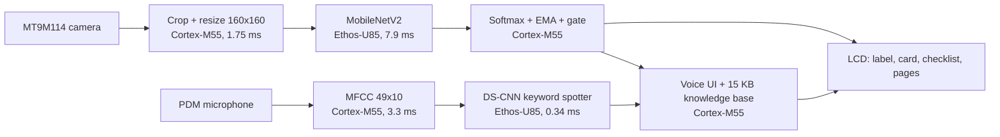

# DCSM-Simplified

*DataCenter Service Management, Simplified.* An offline data-center component identifier on the
**Alif Ensemble E8 DevKit**: Cortex-M55 HP at 400 MHz plus an Ethos-U85-256 NPU.

Point the camera at a component and the NPU names it. Then your voice holds the part, runs an
inspection checklist and pages through its specs, troubleshooting, LED codes and maintenance.
There's no phone, no network, no cloud, and no stored images.

| | |
|---|---|
| **Landing page and slides** | https://abhijitbetigeri.github.io/executorch-alife8/ |
| **Demo video** | https://abhijitbetigeri.github.io/executorch-alife8/demo.mp4 (also on the landing page, under Demo) |
| **Full repository** | https://github.com/abhijitbetigeri/executorch-alife8 at commit [`db9df28b`](https://github.com/abhijitbetigeri/executorch-alife8/tree/db9df28b8f85ac7f6d77d2aa8e0e8e1779662e4b) |
| **Trained models** | https://huggingface.co/abhijitbetigeri/dcops-e8 (deployed `.pte` files, PyTorch weights, ablations, teachers) |
| **Team** | `TODO(names)` |

This pull request carries our project code in [`dcops-e8/`](dcops-e8). The firmware is built on Arm's
ML Embedded Evaluation Kit (MLEK) rather than this starter, so the files keep their MLEK paths. The
full repository builds as-is (see [Build and run](#build-and-run)).

## What it does

1. **Point.** A MobileNetV2 on the Ethos-U85 identifies the part in **7.9 ms**. The LCD shows its name,
   a confidence and an info card. Labels are smoothed over frames and gated by confidence, so an
   unsure model shows nothing rather than guessing.
2. **Hold and check.** Say **"yes"** (or "go"). The part is held and an inspection checklist opens.
   "Yes" and "no" mark each item. A "no" on item 1 ("is this the right part?") rejects the
   identification, so the human corrects the model.
3. **Look it up.** Say **"on"** (or "go" or "right"). The device pages through specs, troubleshooting,
   LED codes and maintenance for that exact part. This is on-device retrieval keyed by what the
   camera saw.

| Say | Action |
|---|---|
| `yes` / `go` / `on` | Hold the identified part and open its checklist |
| `yes` / `no` | Mark the selected item as pass or fail, then advance |
| `on` / `go` / `right`, `left` | Next or previous knowledge page |
| `up` / `down` | Move the cursor |
| `stop` | Back to live scanning |

The demo shows 5 rack-level classes: power shelf, network port, fan, power connector and drive bay,
plus background. These are the ones the board camera separates reliably on held-out data. The model
knows 16; the build option `CLS_ALLOWED_MASK` selects which ones are shown.

## How it meets the judging criteria

| Criterion | Evidence |
|---|---|
| **Functionality and reliability (20)** | The full pipeline runs on the board in one firmware image. Board output matches the PC on the same captured frame, with an identical top-3. On held-out board-camera frames, 79% are labelled correctly, 7% wrongly and the rest blank, and no background frame gets a label. Voice accepts synonyms for robustness in noise. A flash guard refuses images that would overwrite the boot table. |
| **Performance and efficiency (20)** | Vision inference: **7.9 ms** on the NPU. Voice: **0.34 ms** on the NPU plus 3.3 ms for MFCC on the M55. Full frame: **124 ms (8.0 FPS)**, down from 274 ms after we removed per-frame UART logging. Both models fit in 2.4 MB of MRAM, with about 195 KB of headroom. Power was not measured. |
| **Effective use of hardware (15)** | Both models run 100% on the Ethos-U85; only quantize and dequantize stay on the CPU. The Cortex-M55 handles image resizing, audio features, smoothing, retrieval and the UI. The camera, PDM microphone and LCD are all used. The HE core is left free for always-on voice, which is our next step. |
| **Multimodal and sensor integration (15)** | Vision decides *what* the part is. Voice confirms it, drives the checklist and pages the knowledge base, and is only accepted once vision is confident. A "no" on the first item corrects the model. |
| **Innovation and use-case value (10)** | An offline, hands-free servicing aid for air-gapped data-center floors. The roadmap goes from rack-level units down to the 21 part types on a board. |
| **Technical ambition and integration (10)** | We distilled a ConvNeXt teacher into custom students, built a board-camera fine-tuning loop, ran two ExecuTorch models in one image, added on-device retrieval, and found and documented a Vela miscompile. |
| **Engineering quality and demo (10)** | A one-command reproducible build, a guarded flash script, offline tests for the board tools (27 passing), public data, models and slides, and the documentation in `dcops-e8/dcops/docs/`. |

## Architecture and workload placement



| Stage | Runs on | Time |
|---|---|---|
| Camera crop and resize to 160×160 RGB | Cortex-M55 HP | 1.75 ms |
| MobileNetV2 classifier | **Ethos-U85** (100% of layers) | **7.9 ms** |
| Softmax, EMA smoothing, confidence gate, class mask | Cortex-M55 HP | under 1 ms |
| MFCC, 49 frames × 10 coefficients, every 0.5 s | Cortex-M55 HP | 3.3 ms |
| DS-CNN keyword spotter | **Ethos-U85** (100% of layers) | **0.34 ms** |
| Knowledge-page retrieval and LVGL UI | Cortex-M55 HP | — |
| Full frame, including camera and LCD | — | **124 ms, 8.0 FPS** |

To run two ExecuTorch programs side by side, we changed MLEK's `EtModel` from one static `Method` to
one per instance (`dcops-e8/source/lib/mlek/fwk/executorch/EtModel.cc`).

## Models

| Model | Job | Params | Size | Accuracy | Runs on |
|---|---|---|---|---|---|
| YOLOv8n-seg | Auto-labeller for the first training crops | 3.3 M | 6.8 MB fp16 | box mAP50 0.749 | GPU, offline |
| 2× ConvNeXt-Base | Teacher | 2 × 87.6 M | 701 MB | 97.2% on human-labelled val | GPU, training |
| **MobileNetV2**, 160 px, NHWC | Vision: 16 parts + background | **2.25 M** | **2.3 MB int8** | 91.2% on photos; 84.8% on held-out board-camera frames (demo classes) | **Ethos-U85** |
| **DS-CNN** | Voice: 10 keywords + silence + unknown | **79 k** | **93 KB int8** | 94.7% test | **Ethos-U85** |

**NPU, per inference (measured on the E8):**

| | Vision | Voice |
|---|---|---|
| Compute | 152.9 M MACs | 9.1 M MACs |
| NPU latency | 7.9 ms | 0.34 ms |
| Effective throughput | 19.4 GMAC/s | 26.8 GMAC/s |
| Layers on NPU | 100% | 100% |
| On-chip SRAM (Vela) | 755 KiB | 51 KiB |
| Weights in MRAM | 2,280 KiB | 89 KiB |
| int8 matches float top-1 | 98.4–100% of calibration frames | 88.3% of clips |

## How the models were made: distilled, fine-tuned, exported with ExecuTorch

1. **Teacher.** Two ConvNeXt-Base models were trained out-of-fold on 19,203 component crops from
   2,056 labelled data-center photos.
2. **Student.** A MobileNetV2 was distilled from the teacher (α 0.7, T 4) with simulated board-camera
   augmentation. Ablations on board-like images: 91.3% with both, **80.4% without distillation** and
   **75.8% without the augmentation**. In a resolution sweep, 160 px beat 128 and 192.
3. **Board-camera fine-tune.** On the real camera the student scored only about a third right. We
   recorded **1,330 frames from the E8's own camera** while a phone showed a slideshow timed to the
   clock: the laptop reads each frame over J-Link and labels it from the clock. The test set is split
   by slide, so test slides are never trained on, and we mixed in 1,503 replay crops of the original
   photos. Held-out accuracy across all classes rose from **35.5% to 73.0%**. A final pass trained over
   the 6 shown classes and reached **84.8%** top-1 on held-out demo-class frames. The capture tools are
   in `dcops-e8/dcops/board_capture/` and the job is `dcops-e8/dcops/jobs/finetune_board.py`.
4. **Keyword spotter.** A DS-CNN was distilled and trained with the board's automatic gain emulated.
5. **Export** (`dcops-e8/dcops/export/`): `torch.export`, then PT2E int8 with `EthosUQuantizer`
   (symmetric, per channel, calibrated on board frames), then `EthosUPartitioner`, then TOSA, then Vela
   4.5.0 for the U85-256 (Shared_Sram), then Cortex-M passes, producing a `.pte`. We pinned ExecuTorch
   **1.1.0** to match the MLEK runtime.
6. **Vela miscompile.** ExecuTorch 1.1 lowers a conv → permute → reshape tail into transposes that
   cancel out, and Vela miscompiled them. We documented the bug and its workaround in
   [`dcops-e8/docs/blazeface-vela-bug.md`](dcops-e8/docs/blazeface-vela-bug.md).

**Why retrieval rather than a generating LLM.** About 195 KB of memory is left after the two models,
a tiny language model needs about 15 MB, and the voice model knows 10 words, not sentences. So
answers come only from a 15 KB knowledge base compiled into the firmware, and are never invented.

## Build and run

```sh
git clone https://github.com/abhijitbetigeri/executorch-alife8 && cd executorch-alife8
git checkout db9df28b && git submodule update --init --recursive --depth 1
ARM_GCC_BIN=<arm-none-eabi-gcc bin dir> scripts/alif/build_dcops_demo.sh      # -> build-fusion/
scripts/alif/flash_e8_hp.sh build-fusion/bin/mlek_alif_object_detection.axf    # guarded J-Link flash
```

- **Power-cycle after flashing.** Unplug PRG USB for about 10 s; the MT9M114 camera needs it.
- **Camera side.** The camera faces the same side as the LCD. Hold a part, or a photo of one,
  5–7 cm away.
- **Build options.** `CLS_ALLOWED_MASK` (default `0x13250`), `CLS_CONF_THRESHOLD` (0.6) and
  `KWS_THRESHOLD` (0.5) are environment overrides for the build script.
- **Retraining.** Notebooks are in `dcops/colab/` and run on a GPU. Export needs an ExecuTorch 1.1.0
  environment; see `dcops/docs/README_SECTION.md`.

## What's in `dcops-e8/`

| Path | Contents |
|---|---|
| `source/app/use_case/alif_object_detection/` | Classifier mode, info cards and knowledge pages (`gen_class_cards.py`), voice checklist (`VoiceControl.cc`), build options |
| `source/lib/mlek/fwk/executorch/` | `EtModel` with one method per instance, and the DS-CNN keyword-spotter wrapper |
| `dcops/jobs/`, `dcops/colab/` | Teacher, student, keyword-spotter and board fine-tune training |
| `dcops/export/` | ExecuTorch + Ethos-U85 export scripts |
| `dcops/board_capture/` | Clock-synced board-camera capture and dataset builder |
| `dcops/board/` | J-Link measurement, snapshot and flash tools, with offline tests |
| `dcops/docs/` | Architecture, results, Devpost text, demo script |
| `scripts/alif/` | One-command demo build, and a flash script with a boot-table guard |
| `resources/` | The deployed `.pte` models and labels |

## Where this goes

Today the device answers *which unit* to pull or check, at rack level. The servicing win is one
level down: *which part on the board* failed, with its specs and fix. A public dataset already
labels 21 board-level part types across 672 photos (CC BY 4.0): IC, capacitor, electrolytic
capacitor, resistor, resistor network, diode, inductor, transistor, clock crystal, connector, LED,
switch, button, ferrite bead, pins, pads, test point, jumpers and EM. A resistor is about 2 px at our
160 px input, so the next step is a small detector on high-resolution tiles, through the same
ExecuTorch → Ethos-U85 flow. Also next: always-on voice on the HE core and Ethos-U55, and
board-camera data for the 11 trained-but-hidden rack classes.

## Credits and licences

- **Camera pipeline:** the E8 camera pipeline is by Nissan Pow
  ([alif-mlek-yolo](https://github.com/npow/alif-mlek-yolo)).
- **Data:** component photos come from Roboflow Universe datasets under CC BY 4.0. The sources are
  listed in `dcops/data/README.md` in the full repository.
- **Built before the event:** the component dataset and the YOLOv8n-seg auto-labeller. Everything that
  runs on the E8 was built at the event.
- **Tools:** built on Arm MLEK, ExecuTorch 1.1.0, Vela, CMSIS and LVGL.
