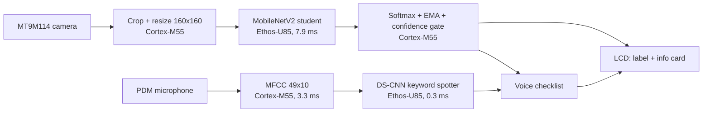

# DC-Ops on E8: an offline data-center component identifier

Arm + ExecuTorch Edge AI Challenge, SFSU, October 17–18 2026. Board: **Alif Ensemble E8 DevKit**
(Cortex-M55 HP at 400 MHz + Ethos-U85-256).

Secure data centers often ban phones, cameras and cloud services on the floor. DC-Ops on E8 is a
single-purpose handheld that runs fully offline. Point the camera at a component and the LCD names it
and shows an info card. Then a hands-free inspection checklist runs by voice. No network, and no
images stored.

- **Full repository:** https://github.com/abhijitbetigeri/executorch-alife8 at commit `TODO(commit)`.
  It is a fork of Arm's ML Embedded Evaluation Kit (MLEK) via
  [npow/alif-mlek-yolo](https://github.com/npow/alif-mlek-yolo).
- **This pull request** holds our project code in [`dcops-e8/`](dcops-e8). The files keep their MLEK
  paths, so you can copy them over that fork to rebuild.
- **Trained models:** [abhijitbetigeri/dcops-e8](https://huggingface.co/abhijitbetigeri/dcops-e8) on Hugging Face (deployed `.pte` files, PyTorch
  weights, ablations, teachers).
- **Demo video:** `TODO(video link)`

## How it works



**Two ExecuTorch 1.1.0 models run in one firmware image** on the HP core. Both run 100% on the NPU, and
only quantize and dequantize stay on the CPU. To run two models at once, MLEK's `EtModel` had to
change from one static method to one method per instance.

**Vision decides what the part is, and voice drives the workflow.** The keyword spotter knows ten
words, and the UI uses six:

| Say | Action |
|---|---|
| `go` | Latch the identified part and open its checklist. This only works when vision is confident. |
| `yes` / `no` | Mark the selected item as pass or fail, then advance. A `no` on item 1 ("is this the right part?") rejects the identification. |
| `up` / `down` | Move the cursor. |
| `stop` | Return to live scanning. |

The demo build shows 5 classes: power shelf, network port, fan, power connector and drive bay, plus
background. The model knows 16. A build option, `CLS_ALLOWED_MASK`, limits the shown classes to the
5 that the board camera separates reliably on held-out data.

## Models: distilled, fine-tuned and exported with ExecuTorch

1. **Teacher.** Two ConvNeXt-Base models, trained on 19,203 component crops cut from 2,056
   labelled data-center photos ([`dcops/data/`](https://github.com/abhijitbetigeri/executorch-alife8/tree/main/dcops/data) in the full repo), reach 97.2% on human-labelled
   validation.
2. **Student.** A MobileNetV2 at 160 px, distilled with simulated board-camera augmentation, reaches
   91.2% on validation photos. Ablations on board-like images: without distillation it drops to
   80.4%, and without the camera augmentation to 75.8%.
3. **Board-camera fine-tune.** On the real camera the student fell to about a third right, because of
   the domain gap. We recorded 1,330 frames from the E8's own camera while a phone showed a
   clock-synced slideshow, and fine-tuned on them with replay. Accuracy on held-out slides rose from
   **35.5% to 73.0%**. In the 5-class demo build, 73% of frames are labelled correctly, 6% wrongly,
   and the rest are blank. No background frame got a label.
4. **Keyword spotter.** A DS-CNN with 79k parameters, distilled and trained with the board's
   auto-gain emulated, scores 94.7% on the test set.
5. **Export.** `torch.export`, then PT2E int8 quantization with `EthosUQuantizer`, then
   `EthosUPartitioner` and TOSA, then Vela 4.5.0 for the U85-256, then a `.pte` file. The int8 and
   float models agree on 98.4% of frames. We found and worked around a Vela miscompile of cancelling
   transposes, documented in [`dcops-e8/docs/blazeface-vela-bug.md`](dcops-e8/docs/blazeface-vela-bug.md).

## Measured on the board

| Metric | Value |
|---|---|
| Vision inference on the Ethos-U85 | 7.9 ms |
| Full frame: capture, inference, display | **124 ms, 8.0 FPS**. It was 274 ms and 3.6 FPS before we removed per-frame UART logging. |
| Keyword spotting: MFCC on M55 + DS-CNN on NPU | 3.3 ms + 0.3 ms, every 0.5 s |
| Model sizes | vision `.pte` 2,301 KB, keyword `.pte` 93 KB |
| Firmware image | ends at 0x805473C4, about 195 KB below the boot-table guard |
| Power | not measured |

The NPU is about 6% of the frame. Camera capture and LCD drawing on the M55 dominate the rest. The
board's top-3 output matches the PC's on the same captured frame.

## Build and run

```sh
git clone https://github.com/abhijitbetigeri/executorch-alife8 && cd executorch-alife8
git checkout TODO(commit) && git submodule update --init --recursive --depth 1
ARM_GCC_BIN=<path to arm-none-eabi bin> scripts/alif/build_dcops_demo.sh
scripts/alif/flash_e8_hp.sh build-fusion/bin/mlek_alif_object_detection.axf
```

After flashing, unplug the PRG USB for about 10 s, because the camera needs a power-cycle. The camera
faces the same side as the LCD. Hold a component, or a photo of one, 5–7 cm in front of it.

## What is in `dcops-e8/`

| Path | Contents |
|---|---|
| `source/app/use_case/alif_object_detection/` | Classifier mode, info cards, voice checklist (`VoiceControl.cc`), build options |
| `source/lib/mlek/fwk/executorch/` | `EtModel` with one method per instance, and the DS-CNN keyword-spotter wrapper |
| `dcops/jobs/`, `dcops/colab/` | Teacher, student, keyword-spotter and board fine-tune training (Colab GPU) |
| `dcops/export/` | ExecuTorch + Ethos-U85 export scripts |
| `dcops/board_capture/` | Clock-synced board-camera capture and dataset builder |
| `dcops/board/` | J-Link measurement, snapshot and flash tools, with offline tests |
| `dcops/docs/` | Architecture, results, demo script, judging evidence |
| `scripts/alif/` | One-command demo build, and a flash script that refuses images that would overwrite the boot table |
| `resources/` | The deployed `.pte` models and labels |

## Team and credits

`TODO(names)`. The E8 camera pipeline is by Nissan Pow
([alif-mlek-yolo](https://github.com/npow/alif-mlek-yolo)). The component photos come from Roboflow
Universe datasets under CC BY 4.0; sources are listed in `dcops/data/README.md`. Built on Arm MLEK,
ExecuTorch 1.1.0 and Vela.
